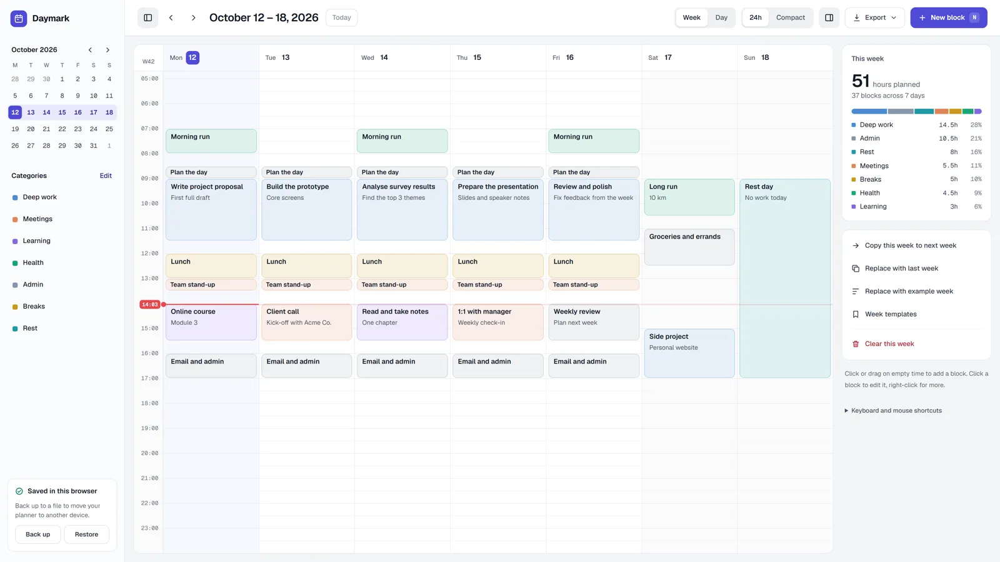

# Daymark Weekly Planner

A free, simple weekly planner for time blocking. Give every hour a job, see where your week goes, and copy a good week forward.

**Open it:** https://sidibem79.github.io/daymark-weekly-planner/

## Why I made it

I learned time blocking in a time management training and did it by hand every week, on paper. It worked. Then life got busy and I stopped. I built this to make the habit easier to come back to.

— Mahmoudou Sidibe

## How to use it

1. **Block your week.** Click or drag on empty time to add a block, then give it a name and a category.
2. **Adjust as you go.** Drag blocks to move them, pull the bottom edge to resize, and tick them off when they're done.
3. **Reuse good weeks.** Copy this week to next week, or save it as a template.

On a phone: swipe to move around, tap a block to edit it, and press and hold a block to move it.

There's a one-minute walkthrough video on the [website](https://sidibem79.github.io/daymark-weekly-planner/#video).

## Your data

Everything is saved in your own browser. There's no account and nothing is sent anywhere. Use **Back up** in the planner to save a copy as a file, and **Restore** to load it on another device.

## Use it offline

The whole planner is one file: [`app/index.html`](app/index.html). Download it and open it in any browser.

## License

[MIT](LICENSE) © 2026 Mahmoudou Sidibe. You're free to use, share and change it.
